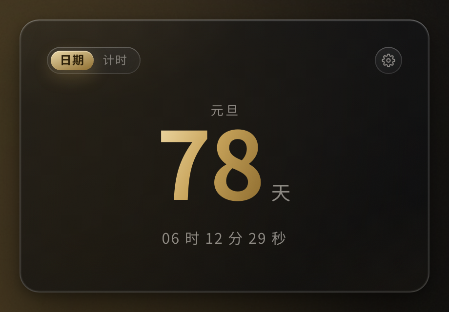
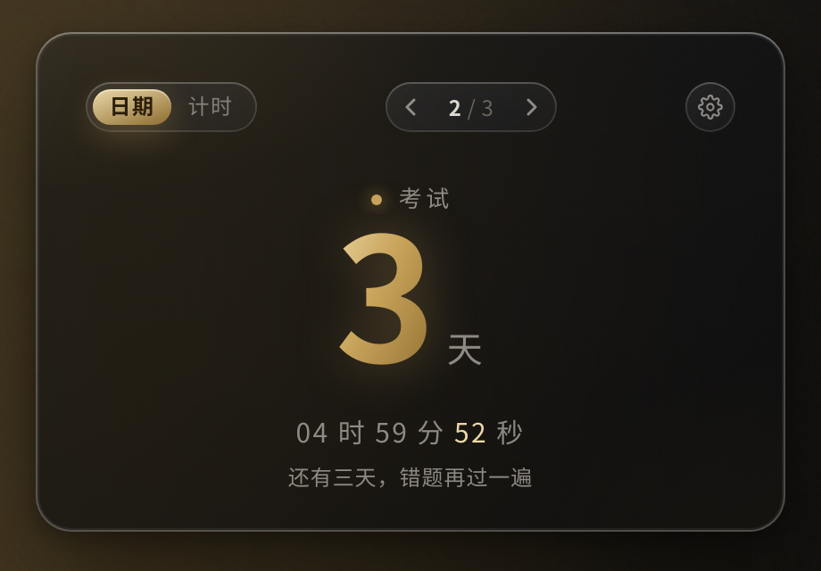
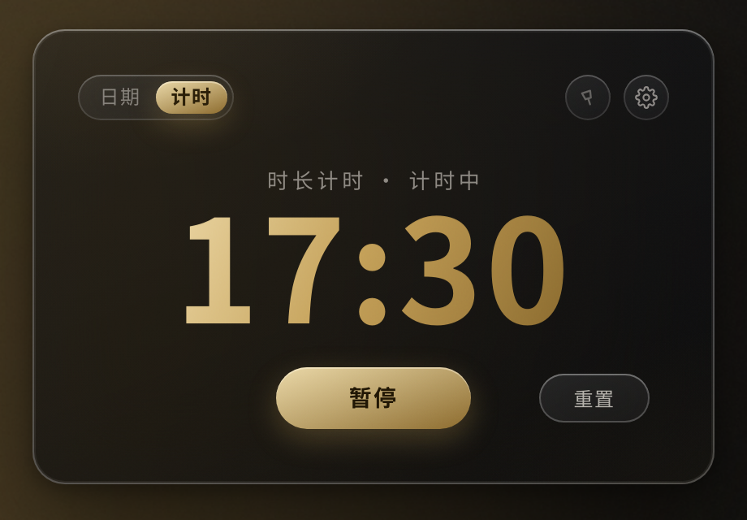

<div align="center">

# GlassHour · 琉璃沙漏

**一块钉在 Windows 10 桌面上的液态玻璃倒计时组件**

鎏金 × 深黑 · 全局液态玻璃 · 不进任务栏 · 开机自启


</div>

---

## 它是什么

GlassHour 不是那种"浮在所有窗口上面挡视线"的桌面时钟。

它把自己**钉在桌面壁纸层**——和你的壁纸活在同一层，被浏览器、编辑器、任何窗口盖住，**不进任务栏、不进 Alt+Tab**。你按 `Win+D` 回桌面时它还在；你干活时它安静地待在后面。

整块卡片是**液态玻璃**：分层模糊、镜面高光扫过、边缘高光折射、极细噪点、柔和投影。主色只有两个——**鎏金**和**深黑**。

## 特性

| | |
| :-- | :-- |
| 🪟 **钉桌面层** | `WorkerW` 子窗口方案，被其它窗口盖住、不进任务栏/Alt+Tab；钉完**自动做「鼠标点得到吗」自检**，点不到就退到兼容模式，绝不会出现「按钮点不动」的死状态 |
| 🔮 **全局液态玻璃** | 卡片整体是玻璃，不是"半透明+模糊"的偷懒版：分层模糊 / 镜面高光 / 边缘折射 / 噪点 / 柔和投影 |
| ⏳ **双模式** | 目标日期倒计时（主数字 = 天）· 时长计时器（MM:SS），卡片上一键切换 |
| 🎨 **鎏金 × 黑** | 唯一强调色是鎏金；剩余不足 7 天自动进入「紧迫」态 |
| 📐 **组件大小 4 档** | 50% / 65% / 80% / 100%，**出厂默认 50%**（桌面配角尺寸）；小档是重排过的迷你版式——隐藏备注与模式胶囊、字号有 11px 下限，不是把大卡硬缩糊 |
| 🚀 **开机自启** | 写注册表 Run 项，开机静默出现在桌面右下角 |
| 📌 **固定 / 解锁** | 右上角图钉 = 真·钉层 + 真·锁位置：固定后拖不动、解锁后能拖到任意地方、再固定就锁在新位置 |
| 🖱️ **位置记忆** | 拖到哪就停在哪，重启后仍在原地；换显示器/改分辨率后自动把窗口拉回可见区域 |
| 🧩 **托盘控制** | 双击托盘图标显示 / 隐藏；右键可切模式、开关固定、开设置、开关自启、桌面层自检、重置位置 |
| ⌨️ **叫得回来** | 隐藏组件后：双击托盘图标 · `Ctrl+Alt+G` · 设置页按钮（隐藏后会变成「显示组件」）——三条路任选 |
| 🔒 **纯本地** | 零联网、零上报、零账户。配置只有一个 `%APPDATA%\GlassHour\config.json` |

## 截图

> `design/shots/` —— 打包前用 Chromium 在真实壁纸上渲染的实拍图（不是示意图）。

| 目标日期 · 默认 | 目标日期 · 紧迫（<7 天） | 时长计时器 · 计时中 |
| :--: | :--: | :--: |
|  |  |  |

## 下载

到 [Releases](../../releases) 取最新版：

- **`GlassHour-Setup-x.y.z.exe`** —— 安装向导，可勾选开机自启
- **`GlassHour-Portable-x.y.z.exe`** —— 免安装绿色版，双击即用

> Windows 10 x64。首次运行若被 SmartScreen 拦，点「更多信息 → 仍要运行」（未做代码签名）。

## 使用

**卡片上**

- **组件大小**：设置页「组件大小」一排 4 档（50/65/80/100%），点了立即生效并记忆；托盘右键也有同款子菜单。换档以**卡片中心**为锚点，观感是「原地变小」
- **右上角图钉 📌** → 「固定 / 解锁」开关
  - 点一下固定：钉进桌面层并且**锁住位置**（拖不动，托盘里会显示「已固定」）
  - 再点一下解锁：脱离桌面层，**可以拖到任意地方**
  - 拖到新地方后再点固定：**锁在新位置**
- 拖动卡片任意空白处 → 移动位置（仅在解锁态）
- 左上角小胶囊 → 切换「日期 / 计时」两种模式
- 计时器模式：中间是 开始 / 暂停，右下角是 重置
- 右上角齿轮 → 打开设置窗口
- 双击卡片 → 也可以打开设置

**托盘图标**（右键）

- 显示 / 隐藏组件
- **固定到桌面 / 解锁**（和卡片上的图钉同一个开关）
- 切换模式
- 设置…
- 开机自启（勾选）
- 桌面层策略（自动 / 强制壁纸层 / 兼容模式 / 普通窗口）+ 钉层前做点击自检 + 立即重钉一次
- **桌面层自检…**（依次试 4 种层级，把「挂得上吗 / 点得到吗」列给你看）
- 重置窗口位置 · 关于 · 退出

### 不小心点了「隐藏组件」？

三条路都能把它叫回来（隐藏的瞬间还会弹一次托盘气泡提醒你）：

1. **双击托盘图标**（通知区域那个金沙漏）
2. **`Ctrl+Alt+G`** 全局快捷键，任何时候都能用
3. **设置窗口底部的按钮** —— 隐藏之后它会自己变成「显示组件」

托盘图标要是被系统折叠进 `^` 里了，点一下 `^` 展开就能看到；也可以在「任务栏设置 → 选择哪些图标显示在任务栏上」里把它固定出来。

> 顺带说一句 v1.3 修掉的一个坑：以前「开机自启」勾上会立刻弹回未勾选——因为写入注册表时带了 `--autostart` 参数、读取时却没带，两边对不上永远读回「未开启」。现在写入后立刻读回校验，读不回来就换一种写法再写一次，并且**以你的勾选为准**，不会再被读回值抹掉。

### 如果它没被钉到桌面层

**先别急着改设置**：v1.3 起，钉层之后会立刻做一次「鼠标点得到吗」自检，点不到会自动退到下一级，所以正常情况下你不需要手动干预。想确认现在到底在哪一层：托盘 → **桌面层自检…**，或看「关于」里的「当前层级 / 点击自检」。

想手动干预时：

- 托盘 → 桌面层 → **兼容模式（桌面之上 · 必定可点击）**：牺牲一点「贴壁纸」的纯度，换取 100% 可点击
- 托盘 → 桌面层 → **强制壁纸层 WorkerW（跳过自检）**：你的机器上自检误判了才用这个

## 从源码构建

```bash
git clone https://github.com/shibry88-netizen/glasshour.git
cd glasshour
npm install
npm start          # 开发运行
npm run dist       # 打 Windows 包（Setup.exe + Portable.exe）
```

在 Linux 上交叉打 Windows 包需要 `wine`；仓库里的 `tools/build_vps.sh` 就是为 Linux 构建机准备的（含国内镜像加速）。

### 只想要 UI 截图

```bash
python3 scripts/make_wallpaper.py   # 生成模拟壁纸（液态玻璃需要背景）
node scripts/screenshot.js          # 输出到 design/shots/
```

## 目录结构

```
electron/
  main.js           主进程：窗口、托盘、开机自启、IPC、固定/解锁总闸门
  desktop-pin.js    桌面层钉死（koffi 调 user32.dll → WorkerW / Progman / sink）+ 点击自检
  layer-policy.js   层级策略纯逻辑（逐级回退链、位置兜底），可单测
  preload.js        contextBridge 安全桥
  store.js          JSON 配置持久化
renderer/
  index.html        组件卡片
  widget.css        液态玻璃样式（设计规范实现）
  widget.js         双模式倒计时逻辑（与视觉解耦）
  settings.html     设置窗口
design/
  设计规范.md        像素级 UI 规范（配色/玻璃分档/坐标表/反例）
  icon.svg          应用图标源文件
docs/
  固定与桌面层.md     图钉到底做了什么 / 四级层级 / 自检原理 / 排障
  构建与部署.md       构建机与出包流程
  代码签名.md         为什么没签名 / 免费签名路线
test/
  layer_policy.test.js  层级策略纯逻辑（无依赖）
  main_logic.test.js    主进程集成测试（含「固定/解锁/再固定」真机链路模拟）
  settings_ui.test.js   设置页渲染层测试（jsdom）
scripts/
  make_wallpaper.py 生成模拟壁纸
  screenshot.js     Playwright 截图
tools/
  build_vps.sh      Linux 构建机出包脚本
```

## 测试

```bash
npm test          # 层级策略 + 主进程集成（不需要 electron / 不需要 Windows）
```

三套都是「不依赖 electron 运行时」的：主进程那套伪造了 electron 模块和 koffi，并在伪 koffi 里搭了一个**迷你 Win32 窗口世界**（Progman / WorkerW / 桌面图标层 / 我们的窗口），所以下面这些行为是**真的被断言过**的：

- 点固定 → `SetParent(widget → WorkerW)` 真的发生，`setMovable(false)`，并且用当前屏幕坐标原地复核
- 固定状态下拖 → 主进程直接拒掉，位置一动不动
- 点解锁 → `SetParent(widget → NULL)` 真的解绑，能拖到任意方向，新位置落盘
- 再点固定 → 钉的是**新位置**，不是老位置
- 壁纸层「点不到」时 → 自动退到兼容层，不会卡在按钮点不动的死状态

想在真机上看到每一级的实际结果：托盘 → **桌面层自检…**。

## 原理速览

**为什么能钉在壁纸层？** Windows 的桌面其实是一个叫 `WorkerW` 的窗口。给它发 `0x052C` 让 Explorer 派生出一个新的 `WorkerW`，把自己 `SetParent` 过去，就和壁纸同层了。`electron/desktop-pin.js` 用 `koffi` 直接调 `user32.dll` 完成这件事，纯 JS、无原生编译。

**为什么不会被任务栏/Alt+Tab 看到？** 窗口用 `skipTaskbar: true` + `focusable: false`，且是 `WorkerW` 的子窗口，本来就不属于顶层窗口。

**为什么图钉是真的？** 挂到壁纸层的窗口有个反直觉的坑：**它通常收不到鼠标点击**——点击命中的是盖在上面的桌面图标层。所以「钉死壁纸层」和「按钮能点」天然打架。GlassHour 的处理是：

1. 钉完立刻用 `GetWindowRect` + `WindowFromPoint` 做一次**真机点击自检**：窗口中心点上，鼠标到底点得到谁？
2. 点得到 → 保留（最强层级，被所有窗口盖住）；
3. 点不到 → 退到 `Progman`，再不行退到 **sink**（`SetWindowPos(hwnd, 桌面图标层, …)`，把自己压在桌面图标之上、所有普通窗口之下，一定可点击），再不行退到普通窗口。
4. 固定状态下还有个 4 秒一次的守卫盯着 `GetParent(hwnd)`；Explorer 重启导致掉层会自动重钉。

细节与排障见 [`docs/固定与桌面层.md`](docs/固定与桌面层.md)。

## 设计

视觉规范见 [`design/设计规范.md`](design/设计规范.md)：完整色板、玻璃分档参数、逐元素坐标表、五种状态的差异、动效曲线、以及一份"不要这样做"的反例清单。

## License

[MIT](LICENSE) © 2026 Shibry
